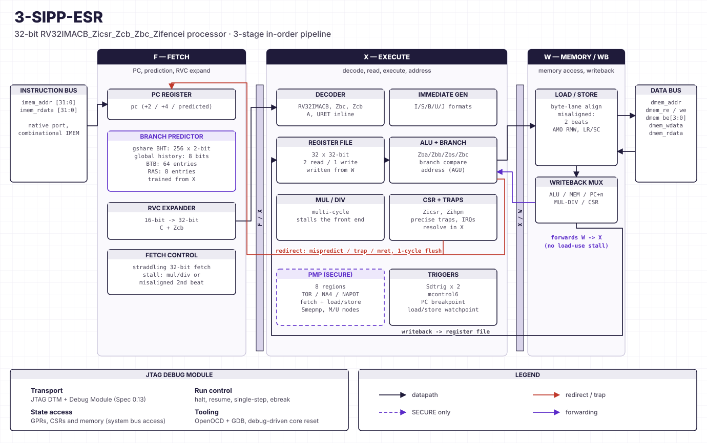

# Architecture

3-SIPP-ESR is a **3-stage, in-order, single-issue** pipeline. One instruction is
fetched, executed, and retired per cycle in the common case; variable-latency
operations (multiply, divide, misaligned access, atomics) extend transparently
through a small set of stall conditions.

## Pipeline

- **IF — instruction fetch + predict.** Fetches the next instruction (32-bit
  or a 16-bit compressed form expanded by the RVC decoder) and consults the
  branch predictor for the next PC. On a predicted-taken branch the front end
  redirects immediately.
- **EX — decode, operand fetch, execute.** Decodes the instruction, reads the
  register file, resolves operands through the forwarding network, and performs
  the ALU / bit-manipulation / branch operation. Multiply/divide is issued to
  the M-unit here; atomics and misaligned accesses drive the memory sequencer.
- **MEM/WB — memory, CSR, writeback.** Performs the data-memory access,
  handles CSR reads/writes, resolves traps precisely, and writes the result
  back to the register file.

## Hazard handling

3-SIPP-ESR has no scoreboard — correctness comes from a compact set of
mechanisms:

- **Forwarding network:** results are bypassed from later stages back to EX so
  back-to-back dependent instructions do not stall. Because load data produced
  in the memory stage is available to a dependent instruction in EX on the same
  cycle, the forwarding network covers load-use hazards too — there is **no
  load-use stall**.
- **Multi-cycle freeze:** multiply/divide, the two-beat misaligned access, and
  the atomic read-modify-write hold the pipeline until they complete.
- **Redirect / flush:** a branch misprediction (or a trap) flushes the wrongly
  fetched instructions and redirects the front end.

## Datapath leaf cells

The reusable datapath blocks live in [`rtl/common/`](https://github.com/OR5-LABS/3-SIPP-ESR/tree/main/rtl/common):
the ALU (with the `B` bit-manipulation ops), the multiply/divide unit, the
register file, the CSR file, the immediate generator, the branch comparator,
the instruction decoder, the RVC (compressed) expander, and the PMP checker.
The core, SoC, UART, AXI4-Lite bridge, and Debug Module live in `rtl/`.

See [Branch Prediction](branch-prediction.md) for the predictor, and
[Instruction Set](isa.md) for the supported ISA.
